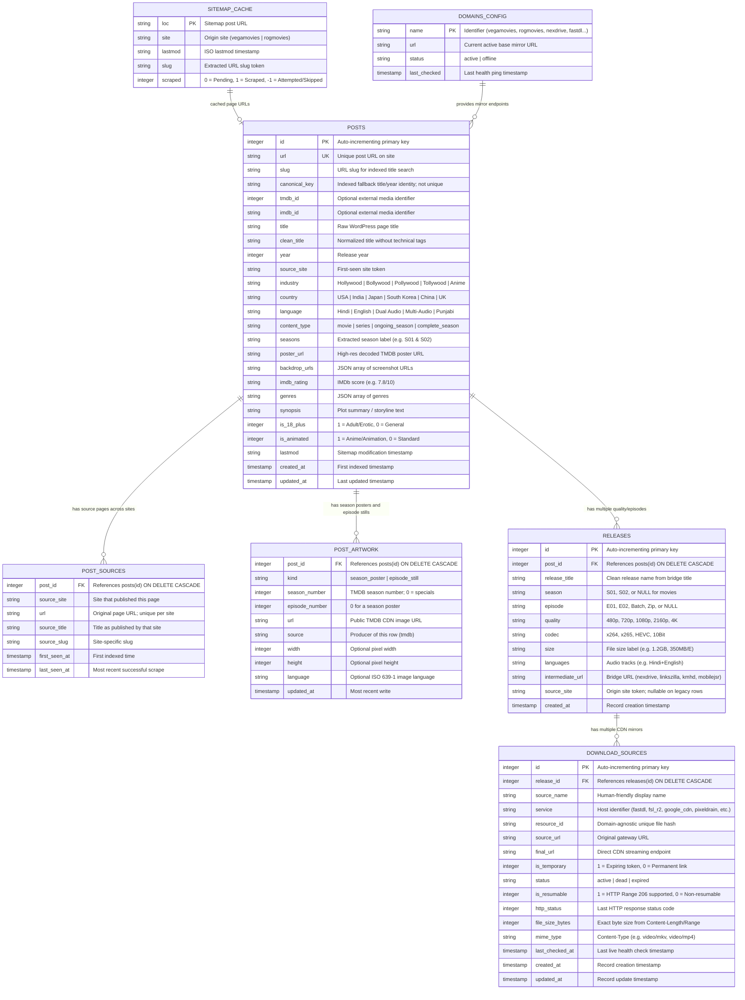

# 🗄️ Fast_Fetch Database Schema & Relational Architecture

This document describes the SQLite architecture, table definitions, foreign keys, constraints, and indexes used by **Fast_Fetch**.

The live schema is created and migrated by `fast_fetch.py`. `canonical_key` is an indexed fallback identity, not a unique constraint: ambiguous title matches or conflicting external IDs must not force different works into one row. `posts.source_site` is the first-seen site; use `post_sources` and `releases.source_site` for all-site attribution.

### Identity and ingestion rules

- Match by compatible IMDb/TMDB identity first, then a previously indexed source
  page URL, then one unambiguous canonical title/year record of the same media
  type. Series and season-pack content types are treated as one series family.
- Reject conflicting external IDs, page mappings, known years, or media types;
  never select an arbitrary row when multiple matches exist.
- SQLite writer transactions reserve the write lock before matching, preventing
  concurrent ingests from creating duplicate master records. Metadata enrichment
  happens before the write lock so network delays do not hold up other writers.
- A refresh with no valid release rows does not erase previously saved releases.
  A non-empty refresh replaces only the matching site's releases.
- Migrations backfill known `posts.url` pages into `post_sources`. They do not
  guess the origin of legacy releases whose `source_site` is unknown.

---

## 1. Relational Entity-Relationship (ER) Diagram

The system operates on an embedded SQLite database (`fast_fetch.db`):



---

## 2. Table Specifications & Fields

### 2.1 Table: `posts`
Stores shared metadata for each confidently matched movie/series entry. The
`url` and `source_site` columns are retained for compatibility and represent
the first-seen page; the `post_sources` table records every site's page.

| Column | Data Type | Constraints | Description |
|---|---|---|---|
| `id` | `INTEGER` | `PRIMARY KEY AUTOINCREMENT` | Internal post ID |
| `url` | `TEXT` | `UNIQUE NOT NULL` | Full original post URL |
| `slug` | `TEXT` | `NULLABLE` | URL slug used for offline keyword search |
| `canonical_key` | `TEXT` | `INDEXED, NOT UNIQUE` | Fallback title/year match key (`slugify(clean_title)_{year}`) |
| `tmdb_id` | `INTEGER` | `NULLABLE, INDEXED` | Optional The Movie Database identity |
| `imdb_id` | `TEXT` | `NULLABLE, INDEXED` | Optional IMDb identity |
| `title` | `TEXT` | `NULLABLE` | Original `<title>` tag from the webpage |
| `clean_title` | `TEXT` | `NULLABLE` | Clean title with audio/resolution noise stripped |
| `year` | `INTEGER` | `NULLABLE` | Extracted release year (e.g. `2024`, `2001`) |
| `source_site` | `TEXT` | `DEFAULT 'vegamovies'` | First-seen site token |
| `industry` | `TEXT` | `NULLABLE` | Industry (`Hollywood`, `Bollywood`, `Pollywood`, `Tollywood`, `Gujarati Cinema`, `Anime`, `K-Drama`, etc.) |
| `country` | `TEXT` | `NULLABLE` | Origin nation (`USA`, `India`, `Japan`, `South Korea`, `China`, `UK`, etc.) |
| `language` | `TEXT` | `NULLABLE` | Primary audio tracks (`Hindi`, `English`, `Hindi + English`, `Punjabi`, `Gujarati`, `Multi-Audio`) |
| `content_type` | `TEXT` | `NULLABLE` | `movie`, `series`, `ongoing_season`, `complete_season` |
| `seasons` | `TEXT` | `NULLABLE` | Season label (e.g. `Season 1 & 2`, `Season 1`) |
| `poster_url` | `TEXT` | `NULLABLE` | High-res TMDB poster (decoded from base64 image proxy or direct TMDB CDN) |
| `backdrop_urls`| `TEXT` | `NULLABLE` | JSON array of screenshot backdrop URLs |
| `imdb_rating` | `TEXT` | `NULLABLE` | IMDb score string (e.g. `7.8/10`, `8.4`) |
| `genres` | `TEXT` | `NULLABLE` | JSON array of genres (e.g. `["Action", "Sci-Fi"]`) |
| `synopsis` | `TEXT` | `NULLABLE` | Storyline synopsis |
| `is_18_plus` | `INTEGER` | `DEFAULT 0` | `1` if 18+/Adult/Erotic, `0` otherwise |
| `is_animated` | `INTEGER` | `DEFAULT 0` | `1` if Anime/Animation/Cartoon, `0` otherwise |
| `lastmod` | `TEXT` | `NULLABLE` | Sitemapped ISO timestamp |
| `created_at` | `TIMESTAMP`| `DEFAULT CURRENT_TIMESTAMP` | Initial ingestion time |
| `updated_at` | `TIMESTAMP`| `DEFAULT CURRENT_TIMESTAMP` | Last updated time |

---

### 2.2 Table: `post_sources`
Maps each successfully ingested site page to the shared `posts.id`. A page URL
is unique within its site, so repeat scrapes refresh its last-seen timestamp
without losing the page's original URL or title.

| Column | Data Type | Constraints | Description |
|---|---|---|---|
| `post_id` | `INTEGER` | `FOREIGN KEY REFERENCES posts(id) ON DELETE CASCADE` | Matched canonical media row |
| `source_site` | `TEXT` | `NOT NULL` | Site identifier |
| `url` | `TEXT` | `NOT NULL` | Original page URL on that site |
| `source_title` | `TEXT` | `NULLABLE` | Title published by that site |
| `source_slug` | `TEXT` | `NULLABLE` | Site-specific slug |
| `first_seen_at` | `TIMESTAMP` | `DEFAULT CURRENT_TIMESTAMP` | Initial successful ingestion |
| `last_seen_at` | `TIMESTAMP` | `DEFAULT CURRENT_TIMESTAMP` | Most recent successful ingestion |

The primary key is `(source_site, url)`. A conflicting reassignment of an
already indexed source URL is rejected rather than silently moving the page.

---

### 2.3 Table: `releases`
A single post often contains dozens of release options (resolutions, audio tracks, single episodes, batch packs).

| Column | Data Type | Constraints | Description |
|---|---|---|---|
| `id` | `INTEGER` | `PRIMARY KEY AUTOINCREMENT` | Internal release ID |
| `post_id` | `INTEGER` | `FOREIGN KEY REFERENCES posts(id) ON DELETE CASCADE` | Parent post ID |
| `release_title` | `TEXT` | `NULLABLE` | Clean release title extracted from bridge/API title |
| `season` | `TEXT` | `NULLABLE` | Season code (e.g. `S01`, `S02`) |
| `episode` | `TEXT` | `NULLABLE` | Episode code (e.g. `E01`, `E12`, `Batch`) |
| `quality` | `TEXT` | `NULLABLE` | `480p`, `720p`, `1080p`, `2160p`, `4k` |
| `codec` | `TEXT` | `NULLABLE` | `x264`, `x265`, `HEVC`, `10Bit` |
| `size` | `TEXT` | `NULLABLE` | File size label (e.g. `450MB`, `1.4GB`, `300MB/E`) |
| `languages` | `TEXT` | `NULLABLE` | Audio languages (e.g. `Hindi+English`, `Japanese`) |
| `intermediate_url` | `TEXT` | `NULLABLE` | Bridge gateway URL (nexdrive, linkszilla, kmhd, mobilejsr) |
| `source_site` | `TEXT` | `NULLABLE` | Origin site token (`vegamovies`, `rogmovies`, `ssrmovies`, `katmoviehd`, `7starhd`) |
| `created_at` | `TIMESTAMP`| `DEFAULT CURRENT_TIMESTAMP` | Creation timestamp |

---

### 2.4 Table: `download_sources`
Stores individual download mirrors and raw CDN streaming endpoints.

| Column | Data Type | Constraints | Description |
|---|---|---|---|
| `id` | `INTEGER` | `PRIMARY KEY AUTOINCREMENT` | Unique download source ID |
| `release_id` | `INTEGER` | `FOREIGN KEY REFERENCES releases(id) ON DELETE CASCADE` | Parent release ID |
| `source_name` | `TEXT` | `NULLABLE` | Display name (e.g. `V-Cloud [FSL Cloudflare R2]`) |
| `service` | `TEXT` | `NULLABLE` | Provider key (see Supported Services list below) |
| `resource_id` | `TEXT` | `NULLABLE` | Service-specific resource identifier |
| `source_url` | `TEXT` | `NULLABLE` | Gateway link found on the bridge page |
| `final_url` | `TEXT` | `NULLABLE` | Resolved source URL |
| `is_temporary` | `INTEGER` | `DEFAULT 0` | `1` if link has an expiring token (~24-48h), `0` if permanent |
| `status` | `TEXT` | `DEFAULT 'active'` | `active`, `dead`, or `expired` |
| `is_resumable` | `INTEGER` | `DEFAULT 0` | `1` if supports Range 206 (pause/resume/IDM), `0` otherwise |
| `http_status` | `INTEGER` | `NULLABLE` | Last probed HTTP status code (200, 206, 400, 404, etc.) |
| `file_size_bytes` | `INTEGER` | `NULLABLE` | Exact file size in bytes from Content-Length or Content-Range |
| `mime_type` | `TEXT` | `NULLABLE` | MIME type (e.g. `video/mkv`, `video/mp4`) |
| `last_checked_at` | `TIMESTAMP`| `NULLABLE` | Timestamp of last health probe |
| `created_at` | `TIMESTAMP`| `DEFAULT CURRENT_TIMESTAMP` | Record creation timestamp |
| `updated_at` | `TIMESTAMP`| `DEFAULT CURRENT_TIMESTAMP` | Record update timestamp |

#### Supported Service Identifiers (`download_sources.service`):

> ⚠️ **Reality (verified against viewer.py + the live staging databases
> 2026-10-22).** The list below is the *intended* canonical vocabulary, and two
> things about it will surprise you:
>
> 1. `/api/v1/posts/{id}` sorts each release's `sources` with a
>    `CASE service WHEN 'pixeldrain' ... WHEN 'vegadrive' ... WHEN 'hubcloud_10g'
>    ... WHEN 'fsl_r2' ... WHEN 'fastdl' ... WHEN 'google_cdn' ... ELSE 99 END`
>    (viewer.py:1946-1961). That `CASE` matches **exact literal strings only**, so
>    `hubcloud` (written by `fast_fetch.py:1929, 1951, 1963, 2006`),
>    `vcloud`, `filepress`, `gofile`, and every other name listed below all fall
>    through to `99` — so this schema list is *not* a tier ranking.
> 2. Real rows frequently carry **host-derived** names outside this vocabulary
>    entirely. `Fast_Fetch/multimovies.db` currently holds values such as
>    `fastdl-beer`, `vcloud-beer`, `filebee-xyz`, `hubcloud-ist`,
>    `one-vegadrive-app`, and `new1-filepress-lat`, none of which match any `CASE`
>    branch — every source in that catalog orders as `99`. Check
>    `SELECT DISTINCT service FROM download_sources` on the database you are
>    actually serving before trusting tier ordering or this list.

* `google_cdn`: Direct Google UserContent CDN stream (`video-downloads.googleusercontent.com`).
* `fsl_r2`: Cloudflare R2 object storage direct stream (`pub-....r2.dev`).
* `pixeldrain`: PixelDrain direct high-speed CDN API stream (`pixeldrain.com/api/file/<id>`).
* `vegadrive`: VegaDrive 10Gbps direct stream (`/d/<id>/skyd`).
* `filepress`: Filepress / Filebee Google Drive proxy stream.
* `fastdl`: FastDL Google CDN stream gateway.
* `vcloud`: V-Cloud token gateway.
* `hubcloud`: HubCloud 10Gbps gateway.
* `firebase`: Google Cloud Firebase Storage direct stream (`firebasestorage.googleapis.com`).
* `workers_dev`: Cloudflare Worker Google Drive streaming reverse proxy (`dl.*.workers.dev`).
* `dropgalaxy`: DropGalaxy VIP storage.
* `gofile`: Gofile.io cloud storage.
* `1fichier`: 1fichier European high-speed storage.
* `megaup`: MegaUp cloud storage.
* `vikingfile`: VikingFile cloud storage.

---

### 2.5 Table: `domains_config`
Dynamic domain mirror table for multi-site routing and surviving frequent ISP/TLD bans.

| Column | Data Type | Constraints | Description |
|---|---|---|---|
| `name` | `TEXT` | `PRIMARY KEY` | Service key (`vegamovies`, `rogmovies`, `nexdrive`, `fastdl`, `vcloud`, `vegadrive`, `filepress`) |
| `url` | `TEXT` | `NOT NULL` | Currently active base URL |
| `status` | `TEXT` | `DEFAULT 'active'` | `active` or `offline` |
| `last_checked` | `TIMESTAMP`| `DEFAULT CURRENT_TIMESTAMP` | Timestamp of last ping |

---

### 2.6 Table: `sitemap_cache`
Indexes the catalog of 16,000+ sitemapped posts locally across Vegamovies & RogMovies for instant offline search.

| Column | Data Type | Constraints | Description |
|---|---|---|---|
| `loc` | `TEXT` | `PRIMARY KEY` | Canonical post URL on the site |
| `site` | `TEXT` | `DEFAULT 'vegamovies'` | Source site token (`vegamovies` or `rogmovies`) |
| `lastmod` | `TEXT` | `NULLABLE` | Sitemapped ISO modification date |
| `slug` | `TEXT` | `NULLABLE` | Extracted title slug used for tokenized search |
| `scraped` | `INTEGER` | `DEFAULT 0` | `0` = pending, `1` = indexed in DB, `-1` = skipped/empty |

---

### 2.7 Table: `post_artwork`
Season-level artwork for a series, kept out of `posts` because one work has many
seasons. `posts.poster_url` remains the work's single poster; this table maps each
TMDB season to its own poster and each episode to its own still. The v1 detail
route publishes these rows as `season_artwork`, and only URLs already on a public
image CDN (`redact.PUBLIC_IMAGE_HOSTS`, which includes `image.tmdb.org`) are
emitted — a scraped site's image URL is dropped rather than leaked. Filled by
`backfill_tmdb.py`; a database with no rows here is valid and simply has no
season artwork mapped.

| Column | Data Type | Constraints | Description |
|---|---|---|---|
| `post_id` | `INTEGER` | `NOT NULL`, `FOREIGN KEY REFERENCES posts(id) ON DELETE CASCADE` | Parent work |
| `kind` | `TEXT` | `NOT NULL` | `season_poster` or `episode_still` |
| `season_number` | `INTEGER` | `NOT NULL`, `DEFAULT 0` | TMDB season number (`0` = specials) |
| `episode_number` | `INTEGER` | `NOT NULL`, `DEFAULT 0` | Episode number; `0` for a season poster |
| `url` | `TEXT` | `NOT NULL` | Public TMDB CDN image URL |
| `source` | `TEXT` | `NOT NULL`, `DEFAULT 'tmdb'` | Producer of the row |
| `width` | `INTEGER` | `NULLABLE` | Pixel width when TMDB supplied metadata |
| `height` | `INTEGER` | `NULLABLE` | Pixel height when TMDB supplied metadata |
| `language` | `TEXT` | `NULLABLE` | ISO 639-1 language of the image |
| `updated_at` | `TIMESTAMP` | `DEFAULT CURRENT_TIMESTAMP` | Most recent write |

The primary key is `(post_id, kind, season_number, episode_number)`, so a rerun
upserts one row per slot instead of duplicating art.

---

## 3. Database Indexes

To maintain sub-millisecond query performance as the catalog scales to tens of thousands of links, the schema defines the following SQLite indexes:

```sql
CREATE INDEX IF NOT EXISTS idx_sources_rel ON download_sources(release_id);
CREATE INDEX IF NOT EXISTS idx_sources_res ON download_sources(resource_id);
CREATE INDEX IF NOT EXISTS idx_releases_post ON releases(post_id);
CREATE INDEX IF NOT EXISTS idx_releases_source_site ON releases(source_site);
CREATE INDEX IF NOT EXISTS idx_sitemap_slug ON sitemap_cache(slug);
CREATE INDEX IF NOT EXISTS idx_sitemap_site ON sitemap_cache(site);
CREATE INDEX IF NOT EXISTS idx_posts_slug ON posts(slug);
CREATE INDEX IF NOT EXISTS idx_posts_source_ind ON posts(source_site, industry);
CREATE INDEX IF NOT EXISTS idx_posts_canonical_key ON posts(canonical_key);
CREATE INDEX IF NOT EXISTS idx_posts_tmdb ON posts(tmdb_id);
CREATE INDEX IF NOT EXISTS idx_posts_imdb ON posts(imdb_id);
CREATE INDEX IF NOT EXISTS idx_post_sources_post ON post_sources(post_id);
CREATE INDEX IF NOT EXISTS idx_post_sources_site_post ON post_sources(source_site, post_id);
CREATE INDEX IF NOT EXISTS idx_post_artwork_post ON post_artwork(post_id, kind, season_number);
```
