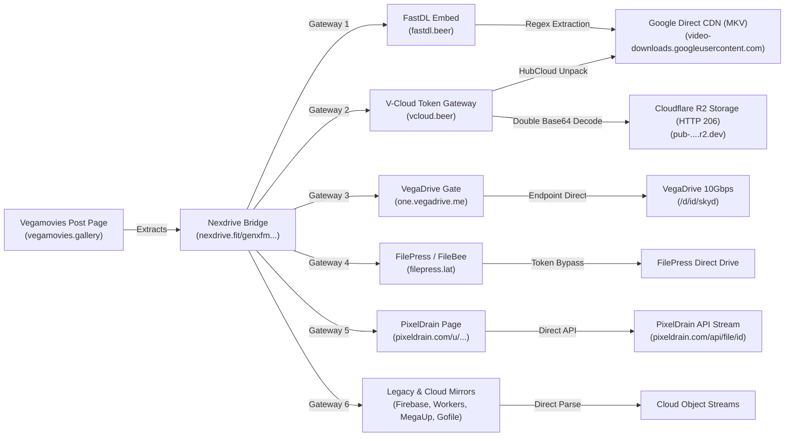
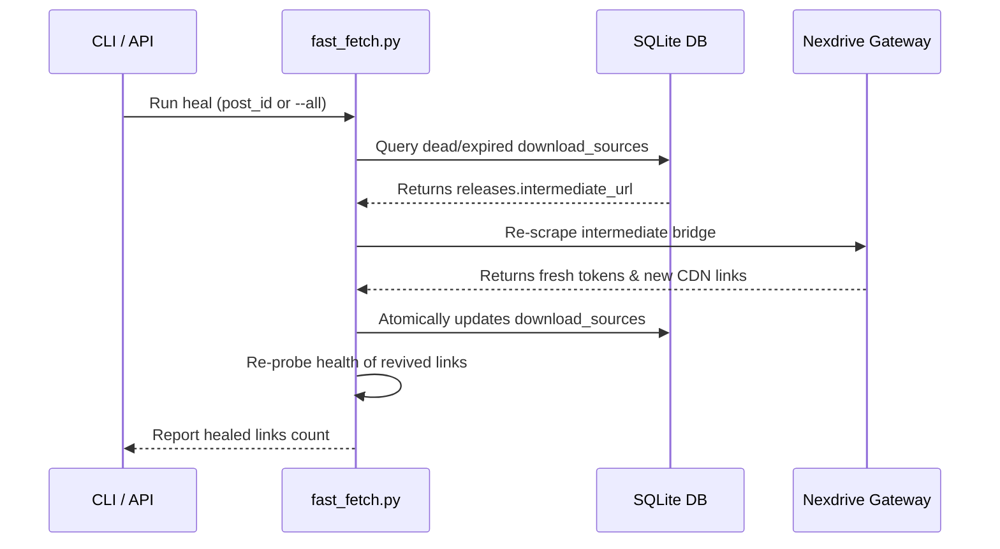

# 🧭 Fast_Fetch Navigators, Bridges & CDN Mechanics

This document provides a comprehensive technical breakdown of every bridge, gateway, host unwrapper, and CDN direct streaming endpoint supported by **Fast_Fetch**.

---

## 1. The Multi-Hop Bridge Flow Overview

Vegamovies media distribution relies on a multi-tiered architecture designed to protect file endpoints from direct hotlinking while delivering high-speed streaming through major cloud providers (Google Cloud, Cloudflare R2, VegaDrive):



---

## 2. Gateway Navigators & Unwrapper Mechanics

### 2.1 FastDL (`fastdl.beer` / `fastdl.zip`)
* **Initial Link Format**: `https://fastdl.beer/embed.php?download=<RESOURCE_ID>`
* **Service Key**: `fastdl`
* **Unwrap Logic**:
  1. Issues HTTP GET request to `embed.php?download=<RESOURCE_ID>`.
  2. The page HTML contains an inline JavaScript redirect definition:
     ```javascript
     var reurl = "https://fastdl.beer/dl.php?link=https://video-downloads.googleusercontent.com/ADGPM2l...";
     ```
  3. Extracted via regex `r'var\s+reurl\s*=\s*["\']([^"\']+)["\']'`.
  4. The query parameter `link=` inside `reurl` contains the unmasked Google CDN URL:
     `https://video-downloads.googleusercontent.com/...`
  5. Content is served with `Content-Type: video/mkv` or `video/mp4` directly from Google's edge cache.
* **Token Characteristics**: Temporary token sessions (~6–12 hours).

---

### 2.2 V-Cloud (`vcloud.beer` / `vcloud.zip`)
* **Initial Link Format**: `https://vcloud.beer/<RESOURCE_ID>`
* **Service Key**: `vcloud`, `fsl_r2`, `google_cdn`
* **Unwrap Logic**:
  1. Requests `https://vcloud.beer/<RESOURCE_ID>`.
  2. The HTML embeds a double Base64-encoded authentication string:
     ```javascript
     var url = atob(atob('YUhSMGNITTZMeTky...'));
     ```
  3. Decodes the base64 payload twice:
     `b64decode(b64decode(token_payload)).decode('utf-8')`
     Yields an authenticated endpoint: `https://vcloud.beer/<RESOURCE_ID>?token=<AUTH_TOKEN>`.
  4. Fetches the token URL and parses available server buttons:
     * **FSL Server (Cloudflare R2)**: `https://pub-....r2.dev/<HASH>?token=...`
       * **Resumability**: Responds with **HTTP 206 Partial Content**, exact byte-range headers (`Content-Range: bytes 0-100/<total>`), and instant seeking support.
     * **HubCloud 10Gbps Server**: `https://gpdl2.hubcloud.ist/?id=<ID>`

---

### 2.3 HubCloud & GPDL Gateway (`hubcloud.ist` / `gamerxyt.com`)
* **Initial Link Format**: `https://gpdl2.hubcloud.ist/?id=<TOKEN_ID>`
* **Service Key**: `google_cdn` / `hubcloud`
* **Unwrap Logic**:
  1. HubCloud GPDL links redirect through intermediate forwarders:
     `https://gpdl2.hubcloud.ist/?id=...` $\rightarrow$ `https://gamerxyt.com/dl.php?link=<GOOGLE_CDN_URL>`
  2. Extracting `link=` immediately unpacks the ultimate raw direct video endpoint:
     `https://video-downloads.googleusercontent.com/...`
  3. Streams direct multi-gigabyte high-speed video files (`video/mkv`) with `Content-Disposition`.
* **Error / Expired Handling**: Expired HubCloud tokens return `HTTP 400` with response body `404 ! ..` via Cloudflare Worker `rohitkiskk.workers.dev`.

---

### 2.4 PixelDrain (`pixeldrain.com`)
* **Initial Link Format**: `https://pixeldrain.com/u/<FILE_ID>`
* **Service Key**: `pixeldrain`
* **Unwrap Logic**:
  1. PixelDrain web links (`/u/<ID>`) normally require human browser navigation and interstitial delays.
  2. Fast_Fetch automatically extracts `<FILE_ID>` via regex `r'/(?:u|d|api/file)/([A-Za-z0-9_-]+)'`.
  3. Maps to PixelDrain's official direct high-speed CDN API:
     `https://pixeldrain.com/api/file/<FILE_ID>`
* **Streaming Advantages**:
  * Direct raw stream with zero ads, captchas, or intermediate redirects.
  * Supports **HTTP 206 Partial Content** range requests.
  * Compatible with multi-connection IDM / aria2 download acceleration and instant VLC seek scrub.

---

### 2.5 VegaDrive (`one.vegadrive.me` / `one.vegadrive.app`)
* **Initial Link Format**: `https://one.vegadrive.app/s/<RESOURCE_ID>`
* **Service Key**: `vegadrive`
* **Unwrap Logic**:
  1. Automatically canonicalizes to the active mirror `https://one.vegadrive.me/s/<RESOURCE_ID>`.
  2. Directly maps to the high-speed 10Gbps streaming endpoint:
     `https://one.vegadrive.me/d/<RESOURCE_ID>/skyd`
  3. Eliminates intermediate confirmation pages.

---

### 2.6 FilePress / FileBee (`filebee.xyz` / `filepress.lat`)
* **Initial Link Format**: `https://filebee.xyz/file/<RESOURCE_ID>`
* **Service Key**: `filepress`
* **Unwrap Logic**:
  1. Canonical resource ID `<RESOURCE_ID>` extracted from `/file/<RESOURCE_ID>`.
  2. Unwrapped through active FilePress mirrors (`new1.filepress.lat`, `new26.filepress.lat`).
  3. Proxies Google Drive direct streams with high bandwidth.

---

### 2.7 Google Cloud Firebase Direct Storage
* **Initial Link Format**:
  `https://firebasestorage.googleapis.com/v0/b/<BUCKET>/o/<ENCODED_PATH>?alt=media&token=<TOKEN>`
* **Service Key**: `firebase`
* **Unwrap Logic**:
  1. Found on legacy posts (2020–2021).
  2. Directly streams `.mkv` files stored on Google Cloud Firebase buckets.
  3. Supports HTTP Range requests and full resumability.

---

### 2.8 Cloudflare Worker Google Drive Gateways
* **Initial Link Format**: `https://dl.<WORKER_NAME>.workers.dev/0:/<FILE_NAME>.mkv`
* **Service Key**: `workers_dev`
* **Unwrap Logic**:
  1. Cloudflare Workers reverse-proxies Google Drive enterprise pools.
  2. Delivers direct downloads without Google authentication prompts.

---

### 2.9 Alternative Cloud Storage Mirrors
Fast_Fetch automatically extracts, normalizes, and stores secondary cloud mirrors found across multi-audio releases:
* **DropGalaxy**: `https://dropgalaxy.vip/<ID>`
* **GDToT / HubDrive**: `https://hubdrive.xyz/file/<ID>` / `https://new26.gdtot.dad/file/<ID>`
* **Gofile**: `https://gofile.io/d/<ID>`
* **1fichier**: `https://1fichier.com/?<ID>`
* **MegaUp**: `https://megaup.mobi/#<ID>`
* **VikingFile**: `https://vikingfile.com/<ID>`
* **7-Up / UpIndia**: `https://7-up.net/<ID>`, `http://upindia.mobi/<ID>`

---

### 2.10 LinksZilla Bridge (`secure.linkszilla.top`)
* **Initial Link Format**: `https://secure.linkszilla.top/view/<ID>`
* **Service Key**: `linkszilla`
* **Unwrap Logic**:
  1. Utilized by SSRMovies as an aggregator bridge.
  2. The page HTML directly renders individual download mirror buttons pointing to:
     * **HubCloud Drive** (`hubcloud.ist/drive/<ID>`)
     * **GDFlix** (`new5.gdflix.io/file/<ID>`)
     * **Direct-Cloud** (`dl.direct-cloud.top/d/<ID>`)
     * **Watch-Online Embedded Player** (`watch-online.mom/e/<ID>`)
     * Secondary hosts: VikingFile, Gofile, 1fichier, MegaUp, UploadFlix, HexLoad.
  3. HubCloud `/drive/` links route to `gamerxyt.com/hubcloud.php`, which unpacks directly to authenticated **Cloudflare R2** signed streams (`r2.cloudflarestorage.com`) and PixelDrain mirrors with full **HTTP 206 Partial Content** resumability.

---

### 2.11 Direct-Cloud (`storage.direct-cloud.org`)
* **Initial Link Format**: `https://dl.direct-cloud.top/d/<ID>`
* **Service Key**: `direct_cloud`
* **Unwrap Logic**:
  1. Requests `dl.direct-cloud.top/d/<ID>`, which returns an immediate HTTP 302 redirect to `https://storage.direct-cloud.org/d/<HASH>`.
  2. Serves direct high-speed video downloads.

---

## 3. Intermediate Bridge Parsing (Nexdrive)

Vegamovies uses Nexdrive (`nexdrive.fit`) as an intermediate bridge between the WordPress post and download hosts. Fast_Fetch parses Nexdrive HTML directly:

### 3.1 Single Releases vs. Multi-Episode Splits
* **Movies**: A single Nexdrive page contains download paragraphs for 480p, 720p, 1080p, or 4K.
* **Web Series / Anime**:
  * Multi-episode Nexdrive pages contain distinct `<p>` tags per episode (`Episode 1`, `Episode 2`...).
  * Fast_Fetch extracts each paragraph independently and builds structured relational entries:
    `E01`, `E02`, `E03`... linked to the parent release variant.
* **Batch Packs**: Titles containing `[Batch]`, `[Zip]`, or `[Complete]` are classified as `episode = 'Batch'` to separate full-season packs from single episodes.

---

## 4. Live Health Diagnostic & Resumability Probing

Fast_Fetch includes an integrated probe engine (`probe_single_source`):

1. **HTTP Range Probing**:
   * Sends HTTP request with `Range: bytes=0-100`.
   * **HTTP 206 Partial Content**: Server supports byte-level streaming $\rightarrow$ `is_resumable = 1`.
   * **Accept-Ranges: bytes**: Validates pause/resume and IDM/aria2 multi-part acceleration.
2. **Metadata Capture**:
   * Reads `Content-Range` or `Content-Length` to compute exact file size in bytes.
   * Reads `Content-Type` to verify video mime-types (`video/mkv`, `video/mp4`).
   * Measures response latency in milliseconds.
3. **Status Classification**:
   * `🟢 active`: HTTP 200, 206, 302.
   * `🟡 expired`: HTTP 401, 403, or expired token session.
   * `🔴 dead`: HTTP 400, 404, DNS error, or connection failure.

---

## 5. Automated Self-Healing Mechanics (`heal`)

When download tokens expire after 24–48 hours:



Because `releases.intermediate_url` is permanently preserved, any dead link can be revived automatically on demand without manually visiting the website.

---

## 6. Dynamic Domain Management & Multi-Site "World Tree" Resilience

Pirate streaming ecosystems frequently shift top-level domains (e.g. `.gallery` $\rightarrow$ `.yt` $\rightarrow$ `.vip`; or RogMovies `.wtf` $\rightarrow$ `.one`) to bypass ISP blocks and registrar suspensions. Fast_Fetch employs a 4-layered defense mechanism:

### 6.1 Silent 301/302 Redirect Auto-Updating
Every request made through `http_get()` checks the post-redirect URL (`resp.geturl()`). When a domain like `nexdrive.fit` redirects to `nexdrive.beer`, Fast_Fetch immediately:
1. Detects the new domain origin.
2. Updates `domains_config` in SQLite.
3. Automatically updates in-memory domain resolution tables without interrupting crawls.

### 6.2 Pre-Fetch URL Normalizer (`normalize_url`)
Historical URLs stored with deprecated domains (e.g. `https://rogmovies.wtf/...`) are rewritten on the fly to the latest active mirror (`https://rogmovies.one/...`) before making network requests.

### 6.3 Sister-Site Cross-Link Harvester (`harvest_sister_domains`)
Vegamovies and RogMovies maintain real-time navigation links to each other and sister network properties (GokuHD, PrimeHub) directly in their website headers:
* When one site updates its header link to point to a new live domain for a sister site, `harvest_sister_domains()` captures the new domain immediately:
  * `Vegamovies` $\longleftrightarrow$ `RogMovies` $\longleftrightarrow$ `GokuHD` $\longleftrightarrow$ `PrimeHub`

### 6.4 Candidate TLD Fallback Prober (`probe_candidate_domains`)
If an active mirror goes completely dark without leaving an HTTP 301 redirect, Fast_Fetch automatically probes candidate TLD variations (`.one`, `.gallery`, `.wtf`, `.vip`, `.beer`, `.im`, `.site`, `.pm`, `.cat`) and binds to the first live responding host.

### 6.5 Full Database URL Migration Engine
When a domain permanently retires, users can rewrite every historical record in a single atomic transaction:
```powershell
python fast_fetch.py domain migrate rogmovies.wtf rogmovies.one
```
This rewrites all matching URLs across `posts`, `releases`, `download_sources`, `sitemap_cache`, and `domains_config`.

---

## 7. Multi-Site Architecture & Taxonomy

Fast_Fetch treats each streaming ecosystem as a specialized branch of direct CDN infrastructure, aggregating and deduplicating titles under master media entities:

| Attribute | Vegamovies (`vegamovies.gallery`) | RogMovies (`rogmovies.one`) | KatMovieHD (`katmoviehd.fans`) | SSRMovies (`ssrmovies.gripe`) | 7StarHD (`7starhd.rich`) |
|---|---|---|---|---|---|
| **Target Catalog** | Hollywood & International Cinema, Western Series, Anime | Bollywood, Tollywood, Pollywood, South Dubbed, Indian Series | Multi-Audio Hollywood, Anime, Ultra HD 4K, Dual Audio | Hindi Dubbed, Dual Audio, SSR Exclusives, Web Series | Bollywood, Dual Audio, Hindi Dubbed Movies & Web Series |
| **Bridge Engine** | Nexdrive (`/genxfm...`) | Nexdrive (`/genxfm...`) | Dandndn API (`api.dandndn.one/api/v1/file/<id>`) | LinksZilla (`secure.linkszilla.top/view/<id>`) | MobileJSR (`mobilejsr.com/view/<id>`) |
| **CDN Gateways** | Cloudflare R2, HubCloud, FastDL, V-Cloud, Google CDN | Cloudflare R2, HubCloud, FastDL, V-Cloud, Google CDN | HubCloud Drive, KatDrive, GDFlix, 1fichier, Send.cm | Direct-Cloud, HubCloud Drive, GDFlix, Gofile, MegaUp | Direct CDN streams, is.gd shorteners, Cloud mirrors |
| **Database Tagging** | `post_sources` / `releases.source_site` | `post_sources` / `releases.source_site` | `post_sources` / `releases.source_site` | `post_sources` / `releases.source_site` | `post_sources` / `releases.source_site` |
| **Taxonomy** | Hollywood, Anime, K-Drama, C-Drama | Bollywood, Tollywood, Pollywood, South Dubbed | Hollywood, Anime, KatDrama, Ultra HD 4K | Hollywood Dubbed, Bollywood, SSR Special | Bollywood, Hollywood Dual Audio, South Hindi |
| **Domain Resilience** | `.gallery` / `.yt` redirect tracking | `.one` / `.wtf` redirect tracking | `.fans` mirror from `katmovieshd.net` | `.gripe` redirect from `ssrmovies.games` | `.rich` / candidate TLD probing |
