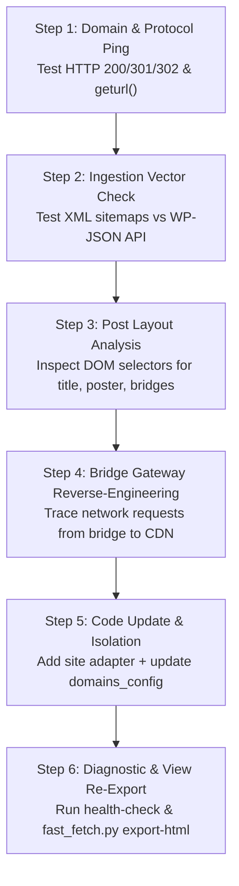

# 🧠 Fast_Fetch Master AI Architecture & Self-Healing Runbook
> **"The World Tree Root Engine"** — Universal Reference, Site Ingestion Protocol, Bridge Reverse-Engineering Playbook & Master Context for AI Collaborators.

> **STRICT DATABASE MERGE GATE:** Never merge a per-site staging database into
> the unified or Oracle catalog unless the user explicitly requests that exact
> merge in the current conversation. Completion or historical notes are not
> approval. State the exact sources, target, current row counts, and verified
> backup/rollback plan, then obtain a separate explicit user confirmation.
> The CLI requires `--owner-authorized`; do not bypass it through a direct
> function call or another write path.

---

## 1. Executive Mission & North Star Architecture

### 1.1 The Core Mission
**Fast_Fetch** is an ultra-fast, zero-external-dependency Python engine and relational media database built to:
1. **Unwrap Protected Streaming Endpoints**: Bypass ad walls, link shrinkers, token gateways, and intermediate bridges to extract pure, raw, direct CDN video streams (Google UserContent CDN, Cloudflare R2, VegaDrive 10Gbps, PixelDrain API, GDFlix, HubCloud) directly into SQLite.
2. **Never Download Large Video Files**: Store and verify direct playable streaming URLs and headers rather than wasting local bandwidth or disk space on multi-gigabyte video files.
3. **Survive 20 Years of Domain Bans**: Maintain 4 layers of dynamic domain resilience (silent 301/302 redirect tracking, candidate TLD fallback probing, header cross-link harvesting, and atomic whole-database URL migration).
4. **Self-Heal Expired Links**: When tokenized links expire after 24–48 hours, the engine automatically re-contacts the persistent bridge gateway and regenerates fresh live tokens without re-scraping the original post.

---

## 2. Master Accomplishments & State of the Project

Historical database snapshot recorded on 2026-10-13; verify current database contents before relying on these counts:
* **Embedded Relational Database** (`fast_fetch.db`):
  * **16,025 Cached Sitemap URLs** (14,025 Vegamovies + 2,000 RogMovies).
  * **45 Enriched Media Posts** across Hollywood, Bollywood, Pollywood (Punjabi), Tollywood (South Indian dubbed), Gujarati Cinema, and Complete Anime series.
  * **1,641 Release Variants** (480p, 720p, 1080p, 4K, individual episodes, batch zip packs).
  * **4,266 Direct CDN Sources** (🟢 **4,024 Verified Active**, ⚡ **260 Resumable HTTP Range 206**).
* **Multi-Site Taxonomy**:
  * Shared media records with per-site page/release provenance; site, industry, country, and language remain queryable.
* **Zero-Dependency Modern Web Explorer** (`viewer.py` & `database_view.html`):
  * Instant search, VLC M3U playlist generation, live link health diagnostics, 1-click on-demand link resolution, and category filters.

---

## 3. Shared Media Catalog with Per-Site Provenance

A single title may appear on several sites. The database keeps shared identity
separate from each site's page and release provenance.

### The Model: Shared Identity, Traceable Sources

1. **Database Level**:
   * `posts` stores shared media metadata; `posts.source_site` is the first-seen site, not a complete list of origins.
   * `post_sources` maps each `(source_site, URL)` to its shared post and preserves the page title/slug and seen timestamps.
   * `releases.source_site` and each site's sitemap rows preserve source attribution for release variants and discovered pages.
   * `canonical_key` is an indexed fallback, not a unique constraint. Conflicts and ambiguous matches fail rather than merge arbitrarily.
2. **Scraper & CLI Level**:
   * Commands accept an explicit `--site` flag:
     * `python fast_fetch.py sync --site ssrmovies` (only syncs SSRMovies sitemap/API).
     * `python fast_fetch.py crawl 10 --site rogmovies` (only crawls RogMovies).
     * `python fast_fetch.py search "avengers" --site vegamovies` (only searches Vegamovies).
3. **UI & Explorer Level**:
   * The local dashboard (`viewer.py` and `database_view.html`) features:
      * Site badges and indexed-page links where per-site page records are available.
     * Dedicated site switcher tabs in the catalog explorer (`🌐 All Sites`, `🎬 Vegamovies`, `🇮🇳 RogMovies`).
     * Discrete category filters (`🎬 Hollywood`, `🇮🇳 Bollywood & Regional`, `🎨 Anime & Asian`).

---

## 4. SSRMovies Deep-Dive & Bridge Discovery Report

### 4.1 Domain Architecture
* **Historical Domain**: `https://ssrmovies.games/`
* **Current Live Domain**: `https://ssrmovies.gripe/`
* **Redirect Behavior**: Verified HTTP 301/302 permanent redirect from `.games` $\rightarrow$ `.gripe`.

### 4.2 CMS & Ingestion Discovery
* Unlike Vegamovies/RogMovies which use Yoast/RankMath XML sitemaps, SSRMovies protects/redirects XML sitemap requests back to the homepage.
* **Breakthrough Discovery**: SSRMovies has an open **WordPress REST API**:
  * `https://ssrmovies.gripe/wp-json/wp/v2/posts?per_page=100`
  * Returns clean, structured JSON containing:
    * `title.rendered`: Full release headline.
    * `link`: Canonical post URL.
    * `date`: Publishing timestamp.
    * `content.rendered`: Full post body HTML containing all download buttons and bridges.

### 4.3 Bridges & Host Ecosystem Discovered
Inspection of live SSRMovies posts revealed an entirely new set of download bridges:
1. **Linkszilla** (`secure.linkszilla.top/view/<ID>`):
   * Serves as an aggregator bridge page containing direct mirrors to:
     * **GDFlix** (`new5.gdflix.io/file/<ID>`): Google Drive streaming proxy.
     * **HubCloud** (`hubcloud.ist/drive/<ID>`): Compatible with our existing HubCloud unwrapper!
     * **Direct-Cloud** (`dl.direct-cloud.top/d/<ID>` $\rightarrow$ `storage.direct-cloud.org`): Direct high-speed video server.
     * **Watch-Online** (`watch-online.mom/e/<ID>`): In-browser streaming player embed.
     * **VikingFile**, **Gofile**, **1fichier**, **MegaUp**, **UploadFlix**, **HexLoad**, **ClicknUpload**.
2. **Direct-Cloud** (`dl.direct-cloud.top`):
   * Intermediate forwarder redirecting to storage nodes (`storage.direct-cloud.org`).

---

## 5. Universal AI Self-Healing & Site-Adapter Playbook

If in the future ANY supported website changes its domain, HTML structure, or bridge logic, follow this exact step-by-step procedure:



### Step 1: Diagnose Domain Health & Redirects
Run a quick diagnostic to test whether the domain moved or redirects:
```python
import urllib.request
req = urllib.request.Request(target_url, headers={"User-Agent": "Mozilla/5.0"})
with urllib.request.urlopen(req, timeout=10) as resp:
    print("Status:", resp.status)
    print("Final URL:", resp.geturl())
```
* If status is 301/302, capture the new TLD and update `domains_config`.
* If DNS fails (NXDOMAIN), probe candidate TLDs (`.one`, `.gallery`, `.gripe`, `.vip`, `.im`, `.site`, `.beer`).

### Step 2: Determine the Ingestion Vector
Test how the site publishes its catalog:
1. Try RankMath/Yoast sitemaps:
   * `https://<domain>/sitemap_index.xml`
   * `https://<domain>/post-sitemap.xml`
2. If sitemap is blocked or redirects, test WordPress REST API:
   * `https://<domain>/wp-json/wp/v2/posts?per_page=50`
   * If REST API is active, fetch batches of 100 via paginated JSON.

### Step 3: Analyze Post Layout & Selectors
Check where download links live:
* **Vegamovies / RogMovies / GokuHD style**: Look for links containing `/genx` (Nexdrive bridges).
* **SSRMovies style**: Look for links pointing to `linkszilla.top` or `direct-cloud.top`.
* **Other networks**: Look for buttons matching `r'href=["\'](https?://[^"\']*(?:drive|download|cloud|link)[^"\']*)["\']'`.

### Step 4: Reverse-Engineer Any New Bridge
When encountering an unknown bridge (e.g. `Linkszilla`, `GDFlix`, `Katdrive`):
1. Request the bridge URL with a standard browser `User-Agent`.
2. Inspect the returned HTML for:
   * Inline JavaScript redirects (`var url = "..."` or `window.location = "..."`).
   * Base64 encoded strings (`atob("...")`).
   * Direct anchor tags leading to CDN providers (`video-downloads.googleusercontent.com`, `r2.dev`, `pixeldrain.com/api/file/`).
3. Add a dedicated regex parser function in `fast_fetch.py` returning `(service_name, direct_cdn_url, is_resumable)`.

### Step 5: Test and Verify with Real Health Probes
Always verify newly resolved URLs using the built-in HTTP Range probe:
```python
res = probe_single_source(source_url)
# Verify: res["status"] == "active" and res["file_size_bytes"] > 0
```

### Step 6: Update Documentation and Export HTML
```powershell
python fast_fetch.py export-html --output database_view.html
```

---

## 6. Master Prompt for Future AI Sessions

> **Copy and paste the prompt below into any new AI session to immediately resume work with full context:**

```markdown
You are working on the Fast_Fetch codebase located at `I:\radd-stream-v3.1\Fast_Fetch`.
Please read `MASTER_AI_RUNBOOK.md`, `DATABASE_SCHEMA.md`, `NAVIGATORS.md`, and `README.md` first.

Key Architecture Principles:
1. Zero External Dependencies: Use only Python standard libraries (sqlite3, urllib, re, json, pathlib, http.server).
2. Universal Relational Model: All media is indexed in `fast_fetch.db` across `posts`, `releases`, `download_sources`, and `sitemap_cache`.
3. Shared Catalog Provenance: Match media cautiously across sites; retain each site's page and release attribution, and never infer unknown historical attribution from a parent row.
4. CDN Direct Resolution: The goal is always extracting direct playable streaming endpoints (Google CDN, Cloudflare R2, PixelDrain API, HubCloud, VegaDrive) with HTTP Range 206 resumability verification.
5. 20-Year Future-Proofing: Domains are managed dynamically via `domains_config` with silent redirect tracking and atomic database migration (`domain migrate`).
6. Safety Policy: Under no circumstances scrape or index dedicated adult / sexually explicit websites. Focus exclusively on mainstream cinema, TV series, anime, and regional films.

Historical status snapshot (2026-10-13; not a live count for every workspace):
- 16,025 sitemaps cached across Vegamovies and RogMovies.
- 45 media posts, 1,641 release variants, 4,266 direct links.
- Interactive local dashboard on `viewer.py` and standalone offline `database_view.html`.

Please maintain documentation integrity and verify scripts with offline and live tests. Regenerate `database_view.html` from the intended populated database; if the local database is empty, use a temporary output path and preserve any existing populated snapshot.
```
