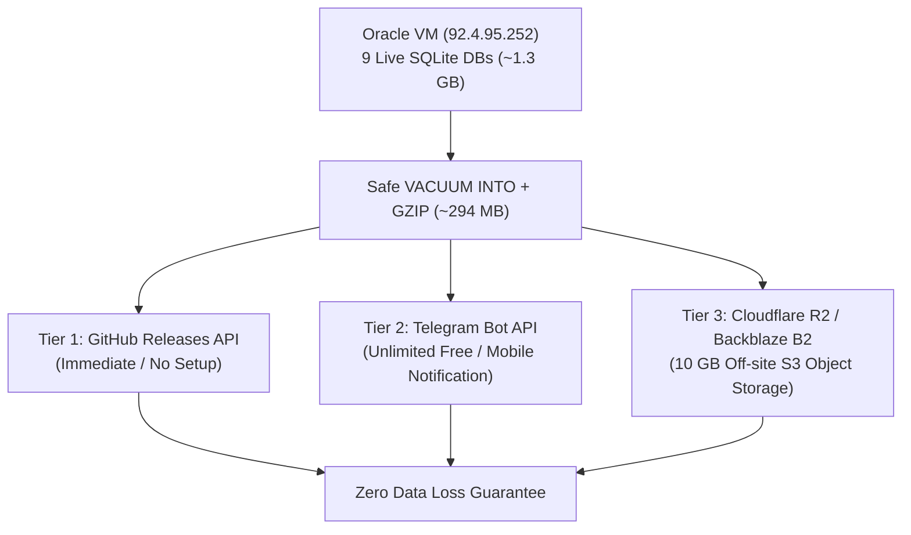

# Cloud Backup Strategy & Free Provider Guide for Radd-Stream

## Executive Summary

Currently, **radd-stream** relies on two single points of failure:
1. **Oracle Cloud VM (`92.4.95.252`)**: Houses **~1.28 GB** across 9 live SQLite databases (`vegamovies.db`, `7starhd.db`, `hdhub4u.db`, `rareanimes.db`, `rogmovies.db`, `ssrmovies.db`, `multimovies.db`, `hdtvb.db`, and `fast_fetch.db`).
2. **GitHub Repository (`radddao/radd-stream`)**: Houses the application code and documentation.

If the Oracle VM terminates, gets banned, or experiences disk failure, hundreds of hours of scraping (over 500,000+ resolved direct stream links) could be lost if not backed up off-site.

To safeguard our data, we implement a **3-2-1 Automated Backup Architecture** leveraging generous, reliable **free-tier** cloud providers with direct API support.

---

## Current Database Inventory (Live on Oracle VM)

| Database | Raw Size | Est. Compressed (`.db.gz`) | Items / Records |
| :--- | :--- | :--- | :--- |
| `vegamovies.db` | 279 MB | ~65 MB | 12,500+ titles, 119,000+ releases, 365,000+ sources |
| `multimovies.db` | 334 MB | ~75 MB | 14,000+ titles |
| `ssrmovies.db` | 272 MB | ~60 MB | Full catalog |
| `rogmovies.db` | 150 MB | ~35 MB | Full catalog |
| `rareanimes.db` | 119 MB | ~25 MB | 13,500+ anime sources |
| `7starhd.db` | 70 MB | ~18 MB | 7,500+ titles (crawling) |
| `hdhub4u.db` | 29 MB | ~8 MB | 1,700+ titles (crawling) |
| `hdtvb.db` | 24 MB | ~6 MB | Archive catalog |
| `fast_fetch.db` | 7 MB | ~2 MB | Golden master database |
| **Total** | **~1.28 GB** | **~294 MB** | **All Scraped Link Intelligence** |

> [!NOTE]
> SQLite databases compress by **70%–80%** when gzipped. Our entire collection of databases fits into **under 300 MB** of compressed archive storage!

---

## Top Free Cloud Providers for Automated API Backups

Here is an objective comparison of the top free-tier cloud storage services that support automated API uploads via Python standard library:

| Provider | Free Storage | Bandwidth / Egress | API Type | Credit Card Needed? | Best For |
| :--- | :--- | :--- | :--- | :--- | :--- |
| **Cloudflare R2** | **10 GB** free / mo | **$0.00 (Zero Egress Fees)** | S3-Compatible REST API | Yes (to activate account) | Production off-site backup & fastest direct downloads |
| **Backblaze B2** | **10 GB** free / mo | 1 GB / day free | Native REST API & S3 API | No credit card for free tier | Simplest HTTP POST backup script |
| **Telegram Bot API** | **Unlimited** storage (2 GB/file) | Unlimited & Free | Simple HTTP POST (`urllib`) | **No (Instant setup via BotFather)** | **Immediate emergency failsafe with zero cost** |
| **Hugging Face Hub** | **50 GB+** per private dataset | Unlimited & Free | Git LFS & REST API | **No** | Perfect for movie metadata databases |
| **GitHub Releases** | **2 GB** per file | Standard GitHub traffic | GitHub REST API (`GITHUB_TOKEN`) | **No (We already have token!)** | Versioned snapshot releases with zero extra accounts |
| **Oracle Object Storage** | **20 GB** free / mo | 10 TB free / mo | OCI REST / S3 API | Included in Oracle Tenancy | In-cloud lightning-fast snapshot before off-site push |

---

## Detailed Evaluation of Recommended Providers

### 1. Telegram Bot API (Private Channel Backup) — ⭐ Fastest Zero-Setup Failsafe
- **How it works**: You create a private Telegram channel (e.g. `radd_stream_backups`) and a free Telegram Bot using `@BotFather`.
- **Why it is incredible**:
  - **Unlimited storage**: Telegram allows uploading files up to 2 GB each for free.
  - **Zero credit card**: Takes 60 seconds to configure.
  - **Instant Notification**: Every time a backup is pushed, you get a ping on your phone with the file attachment and a summary of records scraped.
  - **Standard Library Ready**: Only requires `urllib.request` in Python (no 3rd-party pip dependencies).

### 2. Cloudflare R2 (S3-Compatible Object Storage) — ⭐ Industry Standard
- **How it works**: Cloudflare's S3-compatible object storage.
- **Why it is incredible**:
  - **10 GB Free Storage** every single month.
  - **Zero Egress Fees**: Unlike AWS S3 which charges heavy fees to download your data, Cloudflare R2 charges **$0.00** for outbound bandwidth.
  - Standard S3 protocol: Can be accessed via standard S3 signatures, `rclone`, or simple REST calls.

### 3. Backblaze B2 Cloud Storage — ⭐ Dead-Simple REST API
- **How it works**: Dedicated cloud storage provider known for reliability.
- **Why it is incredible**:
  - **10 GB Free Storage** forever.
  - Free tier does not require entering a credit card.
  - Simple 2-step REST API: call `b2_get_upload_url`, then POST binary data to that URL.

### 4. Hugging Face Datasets (Private Repository) — ⭐ Massive Free Space
- **How it works**: Hugging Face hosts open-source and private datasets.
- **Why it is incredible**:
  - Up to **50 GB** per private repository for free!
  - No credit card required.
  - Movie databases (JSON/SQLite) are literally structured datasets.
  - Can be uploaded using a simple write token via `huggingface.co/api/datasets/...`.

### 5. GitHub Releases (Immediate, Ready Now) — ⭐ Zero Setup Required
- **How it works**: We already have `GITHUB_TOKEN` configured in our environment!
- **Why it is incredible**:
  - GitHub releases allow binary attachments up to **2 GB per file**.
  - We do not need to create any new accounts.
  - Our backup script can simply call `POST https://api.github.com/repos/radddao/radd-stream/releases` and upload `radd-stream-dbs-2026-10-18.tar.gz`.

---

## Safe SQLite Online Backup Architecture

> [!CAUTION]
> **Never copy active SQLite `.db` files directly while crawlers are writing!**
> If you copy `vegamovies.db` while `vegamovies.py` is inserting rows, the WAL (Write-Ahead Log) file `vegamovies.db-wal` may contain uncommitted pages, resulting in a corrupted backup copy.

### The Correct Safe Online Backup Technique:
Python's standard library provides atomic online backups without interrupting running scrapers:

```python
import sqlite3

def safe_backup_sqlite(source_path: str, destination_path: str):
    """Safely snapshots a live SQLite database into a clean destination file."""
    # Method 1: Using VACUUM INTO (cleanest, compacts database)
    conn = sqlite3.connect(source_path)
    try:
        conn.execute(f"VACUUM INTO '{destination_path}'")
    finally:
        conn.close()
```

This guarantees:
1. Active scrapers (PIDs 76635, 120570, etc.) continue writing without interruption.
2. The destination file is a 100% consistent, self-contained single `.db` file with no dangling `-wal` or `-shm` dependencies.
3. The destination file is automatically compacted (`VACUUM`), removing deleted rows and reducing backup size.

---

## Recommended Multi-Tier Architecture (The "Golden Triangle")



---

## Next Steps to Implement

1. **Phase 1 (Immediate / Zero Setup)**:
   - Deploy `radd-stream/Fast_Fetch/backup_manager.py` to Oracle VM.
   - Automatically safe-vacuum, gzip, and upload weekly database snapshots to **GitHub Releases** using our existing `GITHUB_TOKEN`.
2. **Phase 2 (Emergency Alert & Redundancy)**:
   - Create a private Telegram Bot + Channel (takes 2 minutes) for instant daily off-site delivery.
3. **Phase 3 (Enterprise Object Storage)**:
   - Set up free Cloudflare R2 bucket for cold archive storage.
